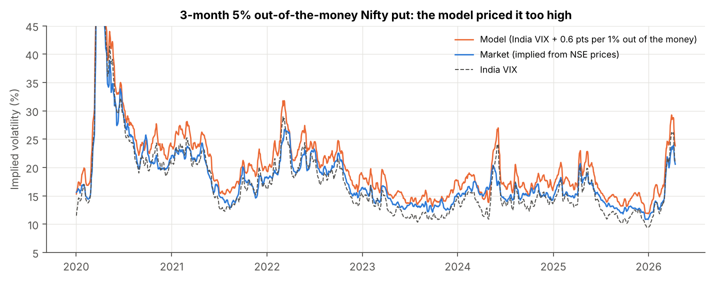
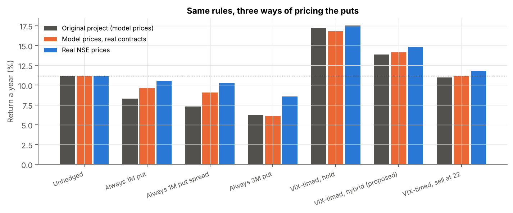

# Nifty crash insurance, tested on real NSE option prices

By **Subh** · [Live app](https://subham-nifty-hedge.streamlit.app) · [](https://subham-nifty-hedge.streamlit.app)

Does buying Nifty put options only when India VIX is low protect a portfolio without dragging down its return? A course project (FDRM, IIT Jodhpur) answered yes, but it priced every option with Black-Scholes because it had no historical option data. This project rebuilds the same backtest on **1.2 million real Nifty option prices** from NSE's daily F&O bhavcopies (Jan 2020 to Apr 2026). It then measures how far the model's prices were from the market's.



## Main findings

| | Result |
| --- | --- |
| Model vs market | Black-Scholes with India VIX plus the assumed put skew priced the hedge puts too high: by a median 33% for 3-month 5% out-of-the-money puts and 21% for 1-month puts, and higher in 91% of purchases. The market charged an implied volatility of about VIX + 1 point for the 3-month put, not VIX + 3. |
| The hedge rule | On real prices, buying a 3-month 5% OTM put only when VIX < 13 (half sold at VIX 22, the rest as the spike fades) returned **14.8% a year** against 11.1% unhedged. Its worst fall was **−22.8%** against −38.4%. On model prices it returned 13.9%. |
| Ranking | Real prices make every hedge cheaper, but the ranking is unchanged. Buying a put every month still costs more than it saves (8.6% to 10.5% a year), and buying only when VIX is low still beats no hedge. |
| Liquidity | 493 of 500 trades used the option's own price on a day it traded at least 50 contracts. The median put bought had 1,510 contracts traded that day and 110,000 in open interest. |
| Robustness | The rule's lead survives bid/ask haircuts up to 10% (14.5% a year), any liquidity cut-off from 10 to 200 contracts, and VIX thresholds from 12 to 14. From July 2020, after the COVID crash, it returned 16.2% against 15.4% unhedged, so most of the full-period lead comes from one put bought in January 2020. |

| Strategy (2 Jan 2020 to 13 Apr 2026, real prices) | Return a year | Volatility | Sharpe | Worst fall | Insurance cost a year | Puts bought |
| --- | --- | --- | --- | --- | --- | --- |
| Unhedged | 11.1% | 18.3% | 0.25 | −38.4% | 0 | 0 |
| Always 1M 95% put | 10.5% | 14.0% | 0.29 | −20.9% | 0.9% | 76 |
| Always 1M 95/85 put spread | 10.3% | 15.7% | 0.24 | −30.4% | 1.0% | 76 |
| Always 3M 95% put, rolled monthly | 8.6% | 12.0% | 0.18 | −15.7% | 2.8% | 76 |
| VIX-timed 3M put, hold to expiry | 17.6% | 15.0% | 0.74 | −17.2% | −4.9% | 22 |
| **VIX-timed 3M put, hybrid selling (course project's proposal)** | **14.8%** | **15.6%** | **0.53** | **−22.8%** | **−3.0%** | **22** |
| VIX-timed 3M put, sell all at VIX 22 | 11.8% | 17.8% | 0.30 | −36.2% | −0.6% | 22 |

A negative insurance cost means the puts earned more than they cost. All figures include a 2% bid/ask haircut on every trade.



## Method

- **Data.** NSE F&O bhavcopies for every trading day from Jan 2020 to Apr 2026, filtered to Nifty options and futures (`data/bhavcopy/`, 34 MB). The download notebook and script are in `data_download/`. Nifty and India VIX closes are the same series as the course project.
- **Contracts.** Each put is a real listed contract: the monthly or quarterly expiry nearest the chosen length, and the strike nearest 5% below Nifty among strikes that traded at least 50 contracts that day. It is held to its real expiry and settled on the Nifty close.
- **Prices.** A strike's own NSE closing price is used when at least 50 contracts traded. Otherwise the price comes from that day's implied-volatility smile, fitted to the liquid strikes of the same expiry. Thin prints can be 50% away from neighbouring strikes, so they are not used. Buys pay the price plus 2% and sales receive the price minus 2%.
- **Like-for-like comparison.** The engine can also price the same real contracts with the course project's model, which separates the effect of real prices from the effect of real expiry dates.
- **Unchanged from the course project.** Period, portfolio (100% Nifty, puts funded by selling Nifty, payouts reinvested), monthly roll dates, VIX thresholds, selling rules and metrics.

**Limitations.** Bhavcopies have end-of-day prices but no bid/ask quotes, so trading cost is an assumption (tested from 0% to 10%). Position sizes are fractions of the portfolio, not whole lots. Dividends are left out. Six years contain one large crash, so the hedge's edge rests on few events.

## Run it

```
pip install -r requirements.txt
python backtest.py          # about a minute: writes output/ and output/results.json
python figures.py           # figures/
streamlit run app/streamlit_app.py
```

To download the data again, open `data_download/nse_fo_download_colab.ipynb` in Google Colab, or run `python data_download/nse_fo_download.py` on any machine that can reach nseindia.com.

## Files

| Path | What it is |
| --- | --- |
| `src/chain.py` | Loads the bhavcopies, picks contracts, prices them (traded close or volatility smile), implied volatility |
| `src/engine.py` | Backtest engine, real or model pricing, same rules as the course project |
| `backtest.py` | Runs every strategy, the model-vs-market comparison and the robustness checks |
| `figures.py` | Charts in `figures/` |
| `app/streamlit_app.py` | Web app, including a tab that re-runs the backtest live |
| `output/results.json` | Every number quoted here |
| `docs/` | Two-page summary (PDF) |

Builds on a group course project (FDRM, IIT Jodhpur): [original app](https://subham-fdrm-vix.streamlit.app), [original code](https://github.com/Subham1709/FDRM_VIX). For learning and research, not investment advice.
